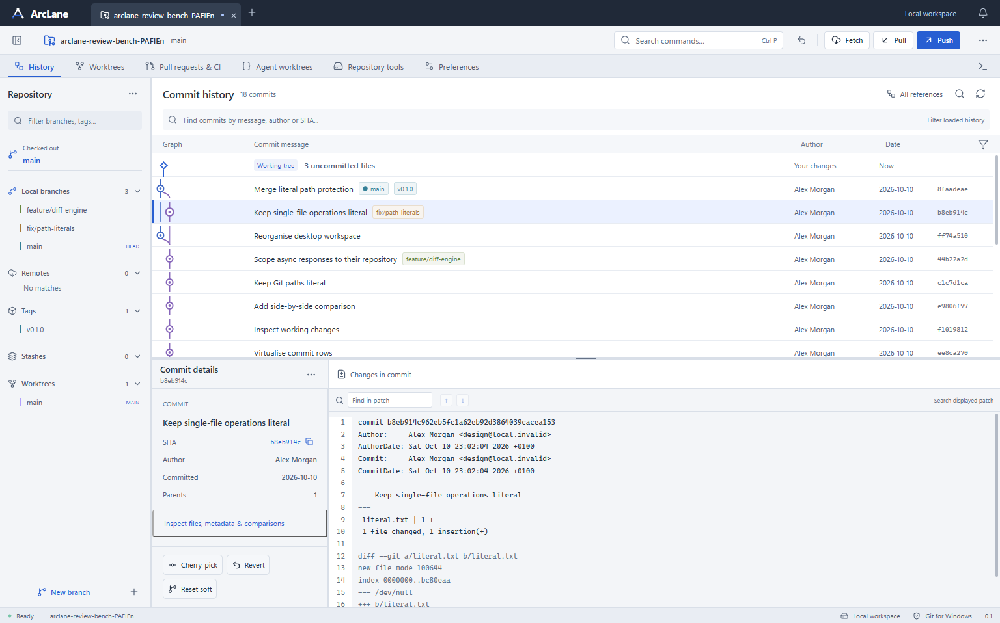
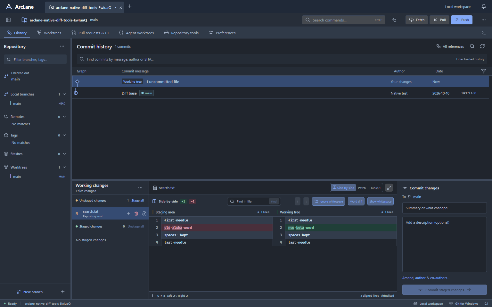

# ArcLane

**Git should be powerful. The desktop app around it shouldn't get in your way.**

A real, local-first Git desktop client for Windows. Built with Rust, Tauri and a lot of testing — plus a healthy amount of AI-assisted development.

**Current release: v0.1.0 · public alpha · not GitKraken feature parity.**

[**Download the Windows alpha**](https://github.com/aloosley-ux/ArcLane/releases/tag/v0.1.0-alpha.1) · [See the 104-feature checklist](docs/FEATURE_COVERAGE.md) · [Read the technical checkpoint](docs/FEATURE_SPRINT_2026-10-10.md)



## Why ArcLane exists

I wanted a capable Git client that felt like a proper desktop tool: a clear graph, straightforward everyday operations, good diff inspection, worktrees, useful terminals and no background AI or subscription service just to manage a local repository.

GitKraken is one of the benchmarks for *what a mature Git client lets people do*. ArcLane is an independent implementation with its own design and code, not a fork, reskin or affiliated product.

The aim is ambitious. The current build is usable for many local Git workflows, but **there is a lot still to build and validate**. I'd rather tell you precisely what works than dress a prototype up as a finished replacement.

## What you can do today

| Area | Current behaviour |
| --- | --- |
| **Repository workspace** | Open, initialise and clone repositories; switch between persistent repo tabs, aliases and recent tabs; inspect branches, refs, stashes and worktrees |
| **History and graph** | Browse/search a virtualised commit graph, inspect commits, compare two commits/refs and review historical changes |
| **Changes and commits** | Stage/unstage whole files or individual hunks; compare file snapshots; create commits, amend messages, override authors and add co-authors |
| **Advanced Git** | Branch/tag operations, fetch/push, pull with fast-forward/merge/rebase strategies, cherry-pick, revert, soft/mixed reset and reflog inspection |
| **Stash and recovery** | Review stash patches, restore index state, guard against stale stash selections; resume or abort paused merge/rebase/cherry-pick/revert after restarting the app |
| **File inspection** | Side-by-side and patch diffs, word highlights, whitespace controls, per-file history, blame and three-way text conflict resolution |
| **Local development** | Worktree tools and embedded on-demand PowerShell terminals via Windows ConPTY |
| **GitHub** | On-demand PR, patch and CI details via your existing `gh` authentication; scoped cancellation, timeouts and actionable errors for provider reads |



These are **working slices**, not claims that every edge case or every GitKraken feature is supported. Some provider write screens have *mock-only* tests, and many advanced workflows are incomplete. Nothing secretly runs an AI model behind your back.

## What is actually verified?

The development record is unusually explicit because it matters:

- The last complete sprint regression passed **14 backend suites (120 grouped checks)** and **16 packaged Windows UI suites**, with a native launch/idle check.
- A later, smaller live GitHub checkpoint passed **6 backend and 8 packaged UI checks** against real public repositories, plus focused provider regressions. It performed **no remote writes**.
- Mutating Git tests use fresh disposable repositories and inspect the resulting refs, index and working files. The UI tests drive the **actual packaged Tauri/WebView2 executable**, not just browser mock-ups.
- The graph has been tested against an 811-commit fixture. **10,000+ commit scalability is not yet established.**

The [full 104-obligation ledger](docs/FEATURE_COVERAGE.md) currently reports **14 accepted local scopes, 51 partial, 5 partial/mock-only, 4 backend-only and 30 unverified**. *Accepted scope* does not mean unlimited production readiness.

Exact evidence and limitations: [feature sprint](docs/FEATURE_SPRINT_2026-10-10.md) · [live GitHub checkpoint](docs/GITHUB_LIVE_CHECKPOINT_2026-10-10.md).

## The honest limitations

The biggest unfinished areas include interactive rebase and multi-commit cherry-pick, core Git cancellation and cross-operation serialisation, deeper worktree/agent-session workflows, stacked PRs, rich/binary/image conflict tooling, additional Git providers, full LFS/submodule lifecycles, signing, accessibility and large-repository performance. Private/enterprise GitHub and live provider writes are not accepted.

This is a Windows-first alpha. **The standalone EXE is unsigned**, so Windows may warn before running it. It requires WebView2 and a local Git installation. GitHub features require `gh` installed and authenticated. It has **not** completed clean-machine installer acceptance.

For important repositories, keep an established Git tool available while ArcLane gains real-world usage. Back up work before trying advanced operations — Git safety is about outcomes, not the presence of a confirmation dialog.

## How it's made

ArcLane is built with **AI-assisted software development**. The product direction, constraints, acceptance criteria and review come from a human; AI coding agents have contributed implementation, investigation, tests and iteration. I'm not claiming it was hand-coded line by line, nor that an AI-generated screenshot proves a working product.

| Layer | Technology |
| --- | --- |
| Desktop | Tauri 2 + Windows WebView2 |
| Git/process logic | Rust backend invoking real local Git and `gh` |
| Interface | React 19, TypeScript, Vite and an original Review Bench design |
| Terminals | Rust portable-pty + Windows ConPTY |
| Verification | Rust/CLI fixture checks, packaged native UI acceptance and independent Git state assertions |

**REA** research helped catalogue observable workflows and build an evidence-backed checklist. **ReAgent** is available in the broader local tooling for differential evaluation, but it is *not* a prerequisite or embedded dependency of ArcLane. No proprietary GitKraken implementation, assets or extracted research are included in this repository.

## Download and build

Get the **Windows portable executable** from [GitHub Releases](https://github.com/aloosley-ux/ArcLane/releases/tag/v0.1.0-alpha.1). This is an alpha build, **not an installer**. Nothing is silently installed as a service.

To build from source on Windows, install Node.js/npm, Rust/MSVC with the Visual Studio C++ build tools, and WebView2:

```powershell
git clone https://github.com/aloosley-ux/ArcLane.git
cd ArcLane
npm ci
npx tauri build --no-bundle
```

For the development app:

```powershell
npm run desktop
```

**Important:** use the Tauri build for a distributable executable. A standalone Rust `cargo build --release` may still point at the Vite development server rather than embedding frontend assets.

For development verification, see [CONTRIBUTING.md](CONTRIBUTING.md). The full native acceptance suite requires a Windows machine, test dependencies and *disposable* Git fixtures; some inherited scripts still expect the original development environment.

## Local-first by design

ArcLane needs no ArcLane account, cloud service, subscription, background repository scanner or background AI model. It reads and writes the repositories you choose. Git remote operations and GitHub queries use their normal external connections **only when requested**.

Commands run with your Windows user's permissions; ArcLane isn't a sandbox. Application and repository settings are local. No telemetry is implemented.

## Where this goes next

The goal is a polished, fast, trustworthy Git client — and ultimately broader workflow coverage. Development tracks actual acceptance rather than pretending the application is finished. See [the feature ledger](docs/FEATURE_COVERAGE.md) for the precise roadmap.

Contributions, bug reports and ideas are welcome. For now, source is publicly visible but **no open-source redistribution licence has been selected**. Please don't assume public visibility grants reuse rights; this will be clarified before opening up licensed contributions.

---

*An independent Git client. Human-directed, AI-assisted, tested against real Git, and still very much in development.*
